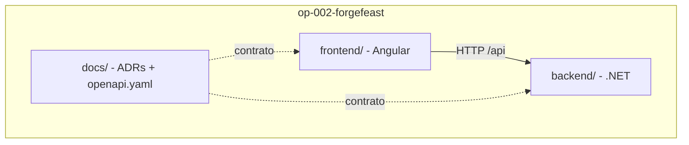

# ADR-001: Usar monorepo com SPA Angular e API ASP.NET Core separadas

Data: 2026-10-27

## Status
Proposto (2026-10-27)

## Contexto
- Briefing OP-002 (ForgeFeast) e feature F00 — Setup do projeto, Sprint 01.
- Restrições: frontend em Angular, backend em ASP.NET Core Web API, banco SQL Server. Sem login, pagamento, integrações externas ou notificações.
- O projeto precisa rodar localmente e ser demonstrado ao vivo; o time é pequeno e trabalha em uma única pasta de operação, que é um repositório git próprio.
- A Definição de Pronto exige testes de unidade e integração na API e E2E nos fluxos principais, todos executáveis a partir do mesmo checkout.
- Alternativas consideradas: (a) dois repositórios; (b) API servindo o build do Angular como arquivos estáticos; (c) um repositório com duas aplicações independentes.

## Decisão
Usaremos um único repositório (monorepo) com duas aplicações independentes:

- `frontend/`: SPA Angular, com build, lint e testes próprios (npm).
- `backend/`: solução .NET com `ForgeFeast.Api` e seus projetos de teste.
- `docs/`: arquitetura, ADRs e contrato OpenAPI.

Em desenvolvimento a SPA roda no `ng serve` (porta 4200) e encaminha `/api/*` para a API (porta 5080) via `proxy.conf.json`, eliminando CORS. Não serviremos o build do Angular pela API nesta operação.

## Consequências
- Positivas: uma única PR pode alterar contrato, API e tela juntos; README único; nenhuma configuração de CORS em desenvolvimento.
- Negativas: duas toolchains (npm e dotnet) no mesmo repositório; o README precisa orientar a subir três processos (banco, API, web).
- A acompanhar: se houver implantação fora da máquina local, decidir em nova ADR entre servir o SPA pela API ou por servidor estático com CORS.
