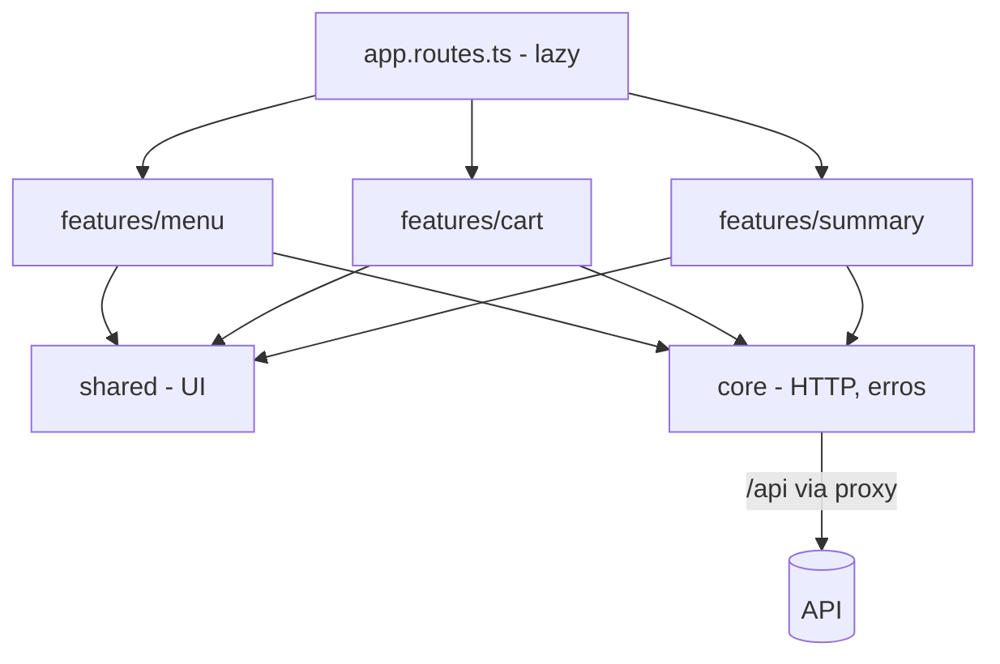

# ADR-011: Estruturar o frontend Angular em core, shared e features com componentes standalone

Data: 2026-10-27

## Status
Proposto (2026-10-27)

## Contexto
- Briefing OP-002: o frontend tem três áreas (cardápio, carrinho, painel de resumo), todas consumindo a mesma API sob `/api` ([ADR-001](ADR-001-usar-monorepo-com-spa-angular-e-api-aspnet-core.md), [ADR-007](ADR-007-manter-contrato-openapi-versionado.md)).
- Três engenheiros de frontend (EMBER, PIXEL, FLINT) podem trabalhar em paralelo; sem fronteiras explícitas, telas passam a importar umas das outras.
- Angular 21 gera projetos com componentes standalone, `signal` para estado local e `loadComponent` para rotas lazy; `NgModule` não é mais necessário.
- Não há login nem estado compartilhado complexo: o carrinho vive na tela da pessoa e o resto vem da API. Bibliotecas de estado global (NgRx etc.) seriam custo sem benefício.
- O esqueleto do F00 (EMBER) já segue `core/`, `shared/` e `features/`, com o health check em `core/health` e a tela em `features/health-status`.

## Decisão
Usaremos uma única aplicação Angular em `frontend/`, sem `NgModule`, organizada assim:

- `src/app/core/`: serviços singleton (`providedIn: 'root'`) e transversais — cliente HTTP base, tratamento de `ProblemDetails` ([ADR-008](ADR-008-padronizar-erros-com-problemdetails.md)) e o serviço de health check. Serviços HTTP de uma feature ficam na pasta da feature, não em `core/`.
- `src/app/shared/`: componentes, pipes e utilitários de UI sem estado de domínio e sem chamada à API.
- `src/app/features/<feature>/`: telas, estado e serviço HTTP de uma feature (ex.: `menu`, `cart`, `summary`); cada uma entra no roteador por `loadComponent`/`loadChildren` em `app.routes.ts`.
- Uma feature não importa arquivos de outra feature; o que precisar ser compartilhado sobe para `shared/` (UI) ou `core/` (serviço transversal).
- Estado local com `signal`/`computed`; RxJS só na borda HTTP. Sem biblioteca de estado global nesta operação.
- Modelos TypeScript (`*.models.ts`) escritos à mão a partir do `docs/api/openapi.yaml`, sem geração de cliente.
- URL da API sempre relativa (`environment.apiBaseUrl = '/api'`), resolvida pelo `proxy.conf.json` em desenvolvimento ([ADR-009](ADR-009-configurar-por-env-e-appsettings.md)).
- Convenções de nome do Angular 21: arquivos em kebab-case sem sufixo `.component` (ex.: `health-status-page.ts`), seletor com prefixo `ff-`.

## Consequências
- Positivas: cada pessoa do frontend trabalha numa pasta própria; rotas lazy mantêm o bundle inicial pequeno; menos dependências para manter.
- Negativas: a regra "feature não importa feature" depende de revisão, não do lint; modelos escritos à mão podem divergir do contrato.
- A acompanhar: se houver importações cruzadas recorrentes, adicionar regra de lint de fronteiras (ex.: `no-restricted-imports` no `eslint.config.js`); se o carrinho precisar sobreviver à troca de rota, decidir onde ele vive (serviço da feature com `signal`) na própria feature P1.
