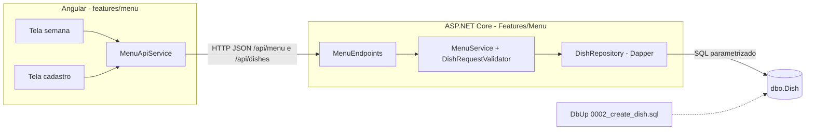

# ADR-012: Definir fronteiras entre Angular, API e SQL Server

Data: 2026-10-27

## Status
Proposto (2026-10-27)

## Contexto
- F01 Cardápio da semana (Sprint 02, P1) é a primeira feature com regra de negócio e tabela própria (`dbo.Dish`). F02 (pedidos), F03 (resumo) e F04 (dados de exemplo) vão repetir o mesmo formato.
- Restrições do briefing: frontend em Angular, API em ASP.NET Core, SQL Server com Dapper e sem EF Core. Sem login: qualquer pessoa usa a tela de cadastro.
- Regras do F01: só dias úteis (POST/PUT recusam sábado e domingo); `weekStart` precisa ser segunda; `name` com 1 a 100 caracteres e `description` com até 300.
- As regras ficam em três camadas. Se cada uma decidir por conta própria, as mensagens divergem, a validação se repete sem uma camada ser a dona, e datas calculadas no navegador podem mudar de dia por causa do fuso.
- Complementa [ADR-001](ADR-001-usar-monorepo-com-spa-angular-e-api-aspnet-core.md), [ADR-004](ADR-004-usar-dapper-sem-ef-core.md), [ADR-005](ADR-005-versionar-schema-com-dbup.md), [ADR-006](ADR-006-estruturar-api-em-minimal-apis-por-feature.md) e [ADR-011](ADR-011-estruturar-frontend-angular-em-core-shared-features.md).

## Decisão
Vamos dividir as responsabilidades assim. A API é a única fonte da regra de negócio.

| Camada | Responsável por | Não faz |
|---|---|---|
| Angular (`features/menu`) | Telas de visualização e de cadastro, prevenção de erro (datepicker sem sábado e domingo, `maxlength`), cálculo da segunda da semana exibida, exibição das mensagens `errors` da API junto ao campo | Decidir se uma requisição é válida; agrupar pratos por dia; chamar SQL ou outra feature |
| API (`Features/Menu`) | Validar entrada (ADR-013), normalizar (`trim`, descrição vazia vira `null`), montar a semana com 5 dias, mapear para os DTOs do contrato | Confiar na validação do cliente; deixar exceção de banco virar a resposta de uma regra |
| SQL Server (`dbo.Dish`) | Persistência, tipos e tamanhos (`DATE`, `NVARCHAR(100/300)`), `NOT NULL` e `CHECK` de dia útil e nome não vazio como última linha de defesa | Ter regra que a API não valida antes. Violação de constraint é bug e responde 500 |

Regras transversais:

- **Datas**: no fio são `yyyy-MM-dd` sem hora. A API usa `DateOnly` e o banco usa `DATE`. No Angular, a data vem de ano, mês e dia locais, nunca de `toISOString()`, que converte para UTC e pode trocar o dia.
- **Acesso a dados**: só pelo `DishRepository` (Dapper, SQL parametrizado, ADR-004). O schema muda por script DbUp `0002_create_dish.sql` e pelos seguintes. Outras features (F02 em diante) leem ou alteram pratos pelo serviço de `Features/Menu`, nunca direto pela tabela.
- **Contrato**: `docs/api/openapi.yaml` (`/api/menu`, `/api/dishes`, `/api/dishes/{id}`). O frontend escreve as interfaces TypeScript a partir dele (ADR-007).
- **Sem login**: o F01 não controla acesso. A dúvida sobre restringir o cadastro ao responsável fica com o PO e não muda estas fronteiras.

## Consequências
- Positivas: uma única fonte de regra (a API), testável em unidade e em integração. O frontend fica fino e as mensagens são as mesmas em todas as telas. O banco barra dados inválidos mesmo se a API tiver um bug.
- Negativas: a regra de dia útil existe em três lugares (datepicker, validador e `CHECK`), e mudar a regra pede alteração nos três. Feriados ficam fora, como o escopo pede.
- A acompanhar: na F02, a remoção de prato com pedidos (409) deve ser checada no serviço antes do `DELETE`, e não apenas pela FK. Se surgir login, uma nova ADR define onde fica a autorização.
