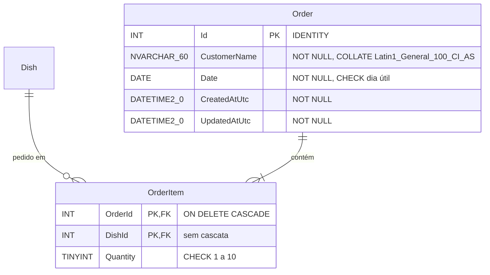

# ADR-016: Modelar pedidos em Order e OrderItem com unicidade no banco

Data: 2026-10-27

## Status
Proposto (2026-10-27; revisado em 2026-10-28: pendência da data do prato encaminhada ao ADR-018)

## Contexto
- F02 RF-09 pede a tabela `OrderItem` com FK para `Dish`, em SQL Server via Dapper e DbUp ([ADR-004](ADR-004-usar-dapper-sem-ef-core.md), [ADR-005](ADR-005-versionar-schema-com-dbup.md)). Um item precisa de um cabeçalho com nome e data.
- RF-06 e R-02: no máximo um pedido por (nome normalizado, data), inclusive com dois POST simultâneos. Uma checagem prévia na API não resolve a corrida.
- Normalizar = trim e ignorar maiúsculas/minúsculas; acentos contam (P-04). O banco do container é criado com o collation padrão do servidor, que não deve ser uma premissa implícita.
- RNF-05: cabeçalho e itens são gravados juntos ou nada é gravado.
- RF-10: prato presente em qualquer pedido não pode ser removido. A F03 vai consolidar pedidos por data.
- `ORDER` é palavra reservada do T-SQL.

## Decisão
Usaremos duas tabelas, `dbo.[Order]` e `dbo.OrderItem`, criadas pelo script `0003_create_order.sql`, com a unicidade garantida por constraint.

- `CustomerName` guarda o nome após o trim feito pela API, com collation explícito `Latin1_General_100_CI_AS` (sem diferenciar maiúsculas, com acentos). `UQ_Order_CustomerName_Date UNIQUE (CustomerName, [Date])` resolve a corrida: a violação (erros 2601/2627) vira 409 no repositório. Espaços no fim já são ignorados na comparação do SQL Server, e o trim do início é da API.
- `CK_Order_CustomerName_NotBlank` (`LEN > 0`) e `CK_Order_Date_Weekday` (mesma fórmula de `CK_Dish_Date_Weekday`) são a última linha de defesa ([ADR-012](ADR-012-definir-fronteiras-entre-angular-api-e-sql-server.md)).
- `IX_Order_Date` em `([Date])` atende a consolidação da F03.
- `OrderItem` tem PK composta `(OrderId, DishId)`, o que também impede prato repetido. `FK_OrderItem_Order` com `ON DELETE CASCADE`; `FK_OrderItem_Dish` sem cascata, para o banco bloquear a remoção de prato com pedidos. `IX_OrderItem_DishId` atende a FK e a checagem de RF-10.
- Os horários `CreatedAtUtc`/`UpdatedAtUtc` vêm do `TimeProvider` ([ADR-015](ADR-015-usar-timeprovider-e-fuso-configuravel-no-corte-de-pedidos.md)), não de `SYSUTCDATETIME()`, para os testes controlarem o valor.
- **Escrita** no `OrderRepository` (Dapper) numa única `SqlTransaction`:
  - Criar: `INSERT` em `[Order]` com `OUTPUT INSERTED.Id`, depois os itens.
  - Alterar: localizar por (nome, data) com `UPDLOCK`, atualizar `UpdatedAtUtc`, `DELETE` dos itens e `INSERT` dos novos.
  - Os itens entram num único comando Dapper com a lista de parâmetros (até 20 linhas, sem TVP).
- Todo SQL usa `dbo.[Order]` entre colchetes. Parâmetros de data seguem o padrão de `DishRepository.AddDate` (`DbType.Date`).

## Consequências
- Positivas: corrida resolvida pelo banco; unicidade independente do collation do servidor; PUT simples (apaga e regrava itens); a F03 lê `Order` + `OrderItem` por data com índice.
- Negativas: o nome `[Order]` exige colchetes em todo SQL (esquecer gera erro de sintaxe, não bug silencioso). Comparação de nomes vale em dois lugares (trim na API, collation no banco). Sem soft delete nem histórico de alterações.
- A acompanhar: se a pessoa puder cancelar o pedido (P-03), o `ON DELETE CASCADE` já cobre os itens. A mudança de data de um prato que já tem pedidos (`PUT /api/dishes/{id}`) fica bloqueada com 409 pelo [ADR-018](ADR-018-bloquear-mudanca-de-data-de-prato-com-pedidos.md). Sem isso, o item apontaria para um prato de outra data.
