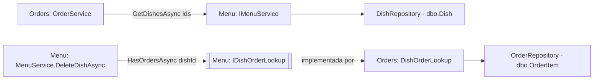

# ADR-017: Integrar Menu e Orders por serviço e por porta de uso do prato

Data: 2026-10-27

## Status
Proposto (2026-10-27)

## Contexto
- [ADR-012](ADR-012-definir-fronteiras-entre-angular-api-e-sql-server.md) e o `overview.md` proíbem uma feature de ler as tabelas de outra; F02 em diante usa pratos pelo serviço de `Features/Menu`.
- `Features/Orders` precisa saber se os pratos do pedido existem e são da data (RF-08) e precisa do nome do prato na resposta (RF-04).
- `Features/Menu` precisa saber se um prato tem pedidos para responder 409 no `DELETE /api/dishes/{id}` (RF-10). O ADR-012 pede essa checagem no serviço, não só pela FK.
- Se Menu chamar o serviço de Orders e Orders chamar o de Menu, surge uma dependência circular.
- R-03: um `DELETE` de prato pode correr em paralelo com a criação de um pedido com esse prato.

## Decisão
Usaremos chamada direta de Orders para Menu e uma porta definida em Menu e implementada em Orders, sem dependência circular.

- **Orders → Menu**: novo `IMenuService.GetDishesAsync(IReadOnlyCollection<int> ids)`, que devolve os `DishResponse` encontrados (com a data). O `OrderService` usa a lista para o 400 de RF-08 (prato ausente ou `dish.Date != order.Date`) e para preencher `dishName` no GET.
- **Menu → Orders por porta**: `Features/Menu/IDishOrderLookup` com `Task<bool> HasOrdersAsync(int dishId, CancellationToken)`. `Features/Orders/DishOrderLookup` a implementa com `SELECT` em `OrderItem` e é registrada por `AddOrdersFeature()`.
- **DELETE de prato**: `MenuService.DeleteDishAsync` passa a devolver `DeleteDishResult` (`Deleted`, `NotFound`, `HasOrders`). Ordem: existência (404), depois uso (409), depois `DELETE`. Se a corrida do R-03 fizer o `DELETE` violar `FK_OrderItem_Dish` (erro 547), o `DishRepository` traduz para `HasOrders`.
- **Corrida inversa**: se o prato some entre a validação e o `INSERT` do item (erro 547 no `OrderRepository`), a resposta é 400 em `items` com a mensagem de prato fora do cardápio.
- 409 do `DELETE`: `title` `Prato com pedidos.`, `detail` `Este prato tem pedidos e não pode ser removido.` A tela de cadastro exibe o `detail`.

## Consequências
- Positivas: nenhuma feature lê tabela alheia; Menu continua testável em unidade com um dublê de `IDishOrderLookup`; as duas corridas terminam em 4xx, nunca em 500.
- Negativas: Menu só funciona com uma implementação da porta registrada (o `Program.cs` precisa chamar `AddOrdersFeature()`); a validação de pratos custa uma consulta extra por pedido, aceitável com até 20 itens.
- A acompanhar: se surgir uma terceira feature consumindo pratos, reavaliar se `IMenuService` deve ser dividido em leitura e escrita.
