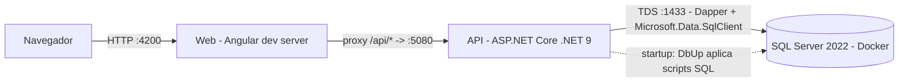
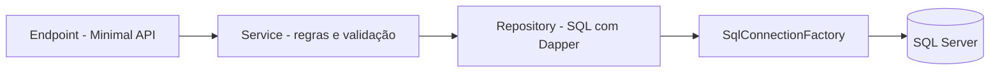

# Arquitetura — ForgeFeast (OP-002)

Data: 2026-10-27
Autor: IRONLAW (Arquiteto)
Escopo: base técnica do projeto (F00 — Setup do projeto). Este documento **não** descreve regras de negócio; elas pertencem às features P1/P2 e aos respectivos tickets.

## 1. Visão geral

ForgeFeast é uma aplicação web local composta por três peças:

- **Web (SPA)**: Angular, servido em desenvolvimento pelo `ng serve`.
- **API**: ASP.NET Core Web API (.NET 9), Minimal APIs, acesso a dados com Dapper.
- **Banco**: SQL Server 2022 em container Docker.



Não há login, pagamento, integrações externas nem notificações (restrição do briefing). A comunicação entre Web e API é só HTTP/JSON sob o prefixo `/api`.

## 2. Versões fixadas (toolchain)

Versões verificadas nesta máquina pelo bridge em 2026-10-27. Ver [ADR-002](adr/ADR-002-fixar-versoes-da-toolchain.md).

| Ferramenta | Versão | Onde é fixada | Como verificar |
|---|---|---|---|
| .NET SDK | 9.0.200 | `global.json` | `dotnet --version` |
| Node.js | 24.11.1 | `.nvmrc`, `engines.node` (exato) em `frontend/package.json` | `node --version` |
| npm | 11.6.2 (acompanha o Node 24.11.1) | `packageManager` em `frontend/package.json` | `npm --version` |
| Docker | 28.3.3 (Engine) com Compose v2 | README | `docker --version` e `docker compose version` |
| Git | 2.51.0 | README | `git --version` |
| Angular | 21.x (major fixado; patch exato no `package-lock.json` após o primeiro `npm install`) | `frontend/package.json` | `npx ng version` |
| SQL Server | 2022, imagem `mcr.microsoft.com/mssql/server:2022-CU27-ubuntu-22.04` | `.env` (`MSSQL_IMAGE`), lido pelo `docker-compose.yml` | `docker compose ps` |
| Pacotes NuGet | versões exatas | `Directory.Packages.props` | `dotnet list package` |

## 3. Estrutura de pastas

```text
op-002-forgefeast/
├── .editorconfig                 # regras de estilo C# e TS (fonte única de formatação base)
├── .env.example                  # variáveis de ambiente de exemplo, sem segredos
├── .gitattributes
├── .gitignore
├── .nvmrc                        # 24.11.1
├── global.json                   # .NET SDK 9.0.200
├── docker-compose.yml            # serviço sqlserver
├── Directory.Build.props         # Nullable, TreatWarningsAsErrors, analyzers
├── Directory.Packages.props      # Central Package Management (versões NuGet)
├── ForgeFeast.sln
├── README.md                     # pré-requisitos e passo a passo
├── scripts/                      # build.sh, lint.sh, test.sh, db-up.sh, run-api.sh (Bash)
├── backend/
│   ├── src/
│   │   └── ForgeFeast.Api/
│   │       ├── Program.cs                # composição: DI, middlewares, mapeamento de endpoints
│   │       ├── appsettings.json
│   │       ├── appsettings.Development.json
│   │       ├── Features/
│   │       │   └── Health/               # único módulo do F00 (ADR-006)
│   │       │       ├── HealthEndpoints.cs    # AddHealthFeature + MapHealthEndpoints
│   │       │       ├── HealthContracts.cs    # DTOs do contrato
│   │       │       ├── IHealthService.cs / HealthService.cs
│   │       │       └── IHealthRepository.cs / HealthRepository.cs
│   │       │   # cada feature futura repete este formato em Features/<Feature>/
│   │       └── Infrastructure/
│   │           ├── Configuration/        # DotEnvLoader (.env só em Development)
│   │           ├── Database/
│   │           │   ├── DatabaseOptions.cs
│   │           │   ├── ISqlConnectionFactory.cs / SqlConnectionFactory.cs
│   │           │   ├── DatabaseMigrator.cs   # DbUp
│   │           │   ├── Migrations/           # NNNN_descricao.sql (embedded resources)
│   │           │   └── Seeds/                # (P2, a criar) dados de exemplo, separados do schema
│   │           └── Errors/               # GlobalExceptionHandler (ProblemDetails)
│   └── tests/
│       ├── ForgeFeast.Api.UnitTests/         # espelha as pastas da API (Features/, Infrastructure/)
│       └── ForgeFeast.Api.IntegrationTests/  # WebApplicationFactory + Testcontainers
├── frontend/                     # ADR-011
│   ├── package.json              # engines.node 24.11.1, packageManager npm@11.6.2
│   ├── angular.json
│   ├── proxy.conf.json           # /api -> http://localhost:5080
│   ├── eslint.config.js
│   ├── .prettierrc.json / .prettierignore
│   ├── tsconfig*.json
│   ├── playwright.config.ts      # config do Playwright
│   ├── e2e/                      # testes E2E Playwright (page objects + specs)
│   └── src/
│       ├── environments/         # apiBaseUrl = '/api'
│       └── app/
│           ├── core/             # serviços singleton e transversais (health, HTTP base, erros)
│           ├── shared/           # UI reutilizável sem estado de domínio
│           └── features/         # uma pasta por feature, rota lazy (health-status no F00)
└── docs/
    ├── api/
    │   └── openapi.yaml              # contrato da API (fonte da verdade)
    └── architecture/
        ├── overview.md               # este documento
        └── adr/
```

## 4. Fronteiras de módulos

| Módulo | Responsabilidade | Depende de | Não pode |
|---|---|---|---|
| `frontend/src/app/core` | HTTP base (`/api`), tratamento de `ProblemDetails`, health check, configuração global | Angular | conter tela ou serviço de feature de negócio |
| `frontend/src/app/shared` | UI reutilizável e sem estado de domínio | Angular | chamar a API |
| `frontend/src/app/features/<x>` | telas, estado (`signal`) e serviço HTTP da feature `<x>` | `core`, `shared` | importar outra feature |
| `ForgeFeast.Api/Features/<X>` | endpoints, DTOs, regras e SQL da feature `<X>` | `Infrastructure` | acessar tabelas de outra feature sem passar pelo serviço dela |
| `ForgeFeast.Api/Infrastructure` | conexão, migrações, configuração, erros | pacotes de infraestrutura | conter regra de negócio |

Fluxo interno de uma requisição na API:



Regras: endpoints não executam SQL; repositórios não contêm regra de negócio; DTOs de contrato (`Contracts`) não são reutilizados como linhas de banco.

## 5. Contrato da API

- Fonte da verdade: [`docs/api/openapi.yaml`](../api/openapi.yaml) (OpenAPI 3.0.3). Ver [ADR-007](adr/ADR-007-manter-contrato-openapi-versionado.md).
- Todos os endpoints ficam sob `/api`. JSON em `camelCase`. Datas no formato ISO 8601 (`yyyy-MM-dd` para datas sem hora).
- Erros: `application/problem+json` (RFC 9457). Ver [ADR-008](adr/ADR-008-padronizar-erros-com-problemdetails.md).
- Endpoint do F00: `GET /api/health` (200 `Healthy` / 503 `Unhealthy`), incluindo verificação do banco.
- Em `Development`, a API publica o documento gerado em `/openapi/v1.json` (Microsoft.AspNetCore.OpenApi) e a Swagger UI em `/swagger`, apenas como apoio de inspeção.
- O F00 não tem nenhum endpoint de negócio; cardápio, pedidos e resumo entram no contrato nas PRs das features P1.

## 6. Configuração

Ver [ADR-009](adr/ADR-009-configurar-por-env-e-appsettings.md).

Precedência na API (maior vence): variáveis de ambiente do processo > `.env` da raiz (carregado só em `Development`, sem sobrescrever o que já existe) > `appsettings.{Environment}.json` > `appsettings.json`.

| Variável | Usada por | Exemplo em `.env.example` | Descrição |
|---|---|---|---|
| `MSSQL_IMAGE` | docker compose | `mcr.microsoft.com/mssql/server:<tag-CU-2022>` | imagem fixada do SQL Server 2022 |
| `MSSQL_SA_PASSWORD` | docker compose | `<defina-uma-senha-forte>` | senha do `sa` local (placeholder, nunca valor real) |
| `MSSQL_PORT` | docker compose | `1433` | porta publicada no host |
| `ConnectionStrings__ForgeFeast` | API | `Server=localhost,1433;Database=ForgeFeast;User Id=sa;Password=<mesma-senha>;TrustServerCertificate=True` | conexão da API |
| `Database__ApplyMigrationsOnStartup` | API | `true` | aplica scripts DbUp ao subir |
| `ASPNETCORE_ENVIRONMENT` | API | `Development` | ambiente |
| `ASPNETCORE_URLS` | API | `http://localhost:5080` | endereço da API |

O frontend não lê `.env`: chama sempre o caminho relativo `/api`, resolvido pelo `proxy.conf.json` em desenvolvimento.

Portas locais: Web `4200`, API `5080`, SQL Server `1433`.

## 7. Qualidade (lint, formatação, testes)

Ver [ADR-010](adr/ADR-010-adotar-ferramentas-de-lint-formatacao-e-testes.md).

| Camada | Lint / formatação | Testes |
|---|---|---|
| API | `dotnet format --verify-no-changes`, .NET analyzers, `TreatWarningsAsErrors` | xUnit (unidade); xUnit + `WebApplicationFactory` + Testcontainers MsSql (integração) |
| Web | `ng lint` (angular-eslint), `prettier --check` | runner padrão do Angular 21 (Vitest) |
| E2E | ESLint/Prettier do frontend | Playwright em `frontend/e2e` |

## 8. Observabilidade

Logs via `ILogger` padrão do ASP.NET Core no console, sem provider externo. Health check em `/api/health`. Sem métricas ou tracing nesta operação (demo local).

## 9. Riscos conhecidos

- **.NET 9 é STS e sai de suporte em 2026-11-10.** Fixamos 9.0.200 por ser o SDK instalado e o exigido pelo comandante; a migração para .NET 10 (LTS) fica registrada como acompanhamento no [ADR-002](adr/ADR-002-fixar-versoes-da-toolchain.md).
- Integração depende de Docker ativo (Testcontainers e banco local).
- Senha do `sa` duplicada entre `MSSQL_SA_PASSWORD` e a connection string no `.env`; aceito pela simplicidade (ver ADR-009).

## Decisões

| ADR | Título | Status | Data |
|---|---|---|---|
| [ADR-001](adr/ADR-001-usar-monorepo-com-spa-angular-e-api-aspnet-core.md) | Usar monorepo com SPA Angular e API ASP.NET Core separadas | Proposto | 2026-10-27 |
| [ADR-002](adr/ADR-002-fixar-versoes-da-toolchain.md) | Fixar versões da toolchain (Node 24.11.1, .NET SDK 9.0.200, Docker 28.3.3) | Proposto | 2026-10-27 |
| [ADR-003](adr/ADR-003-usar-sql-server-2022-em-docker.md) | Usar SQL Server 2022 em Docker como banco principal | Proposto | 2026-10-27 |
| [ADR-004](adr/ADR-004-usar-dapper-sem-ef-core.md) | Usar Dapper para acesso a dados, sem EF Core | Proposto | 2026-10-27 |
| [ADR-005](adr/ADR-005-versionar-schema-com-dbup.md) | Versionar o schema com scripts SQL aplicados por DbUp | Proposto | 2026-10-27 |
| [ADR-006](adr/ADR-006-estruturar-api-em-minimal-apis-por-feature.md) | Estruturar a API em Minimal APIs organizadas por feature | Proposto | 2026-10-27 |
| [ADR-007](adr/ADR-007-manter-contrato-openapi-versionado.md) | Manter o contrato da API em OpenAPI versionado no repositório | Proposto | 2026-10-27 |
| [ADR-008](adr/ADR-008-padronizar-erros-com-problemdetails.md) | Padronizar erros HTTP com ProblemDetails (RFC 9457) | Proposto | 2026-10-27 |
| [ADR-009](adr/ADR-009-configurar-por-env-e-appsettings.md) | Configurar por .env e appsettings com variáveis de ambiente | Proposto | 2026-10-27 |
| [ADR-010](adr/ADR-010-adotar-ferramentas-de-lint-formatacao-e-testes.md) | Adotar ferramentas de lint, formatação e testes | Proposto | 2026-10-27 |
| [ADR-011](adr/ADR-011-estruturar-frontend-angular-em-core-shared-features.md) | Estruturar o frontend Angular em core, shared e features com componentes standalone | Proposto | 2026-10-27 |

Todas as ADRs estão `Proposto` e precisam de revisão e aprovação humana (mudança para `Aceito`, com data) antes de qualquer feature P1 começar.
